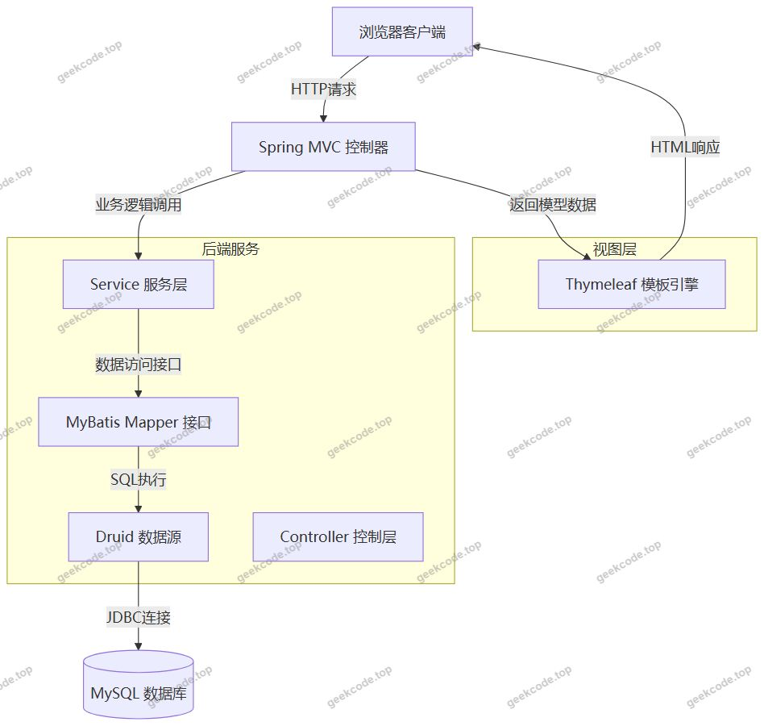
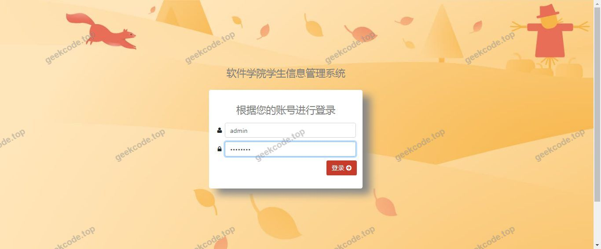
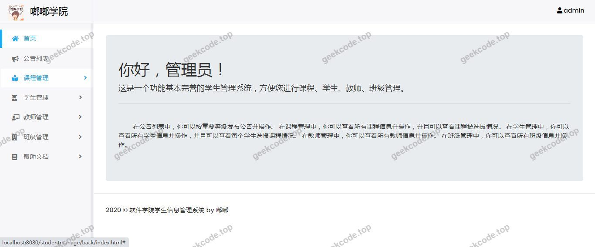
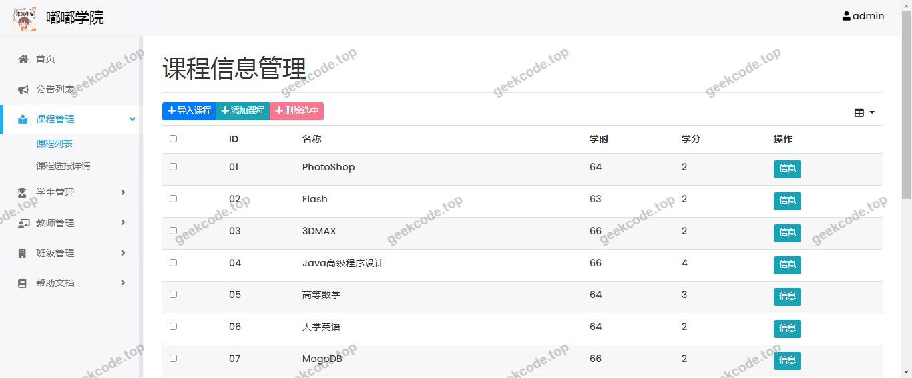
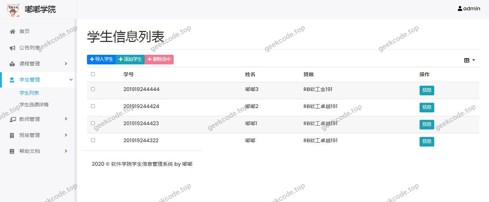
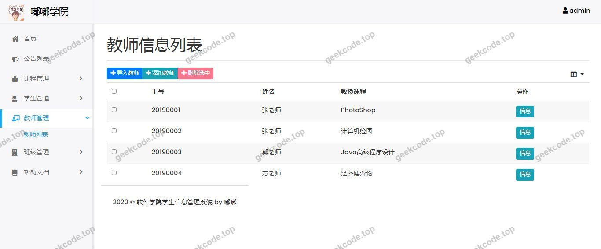
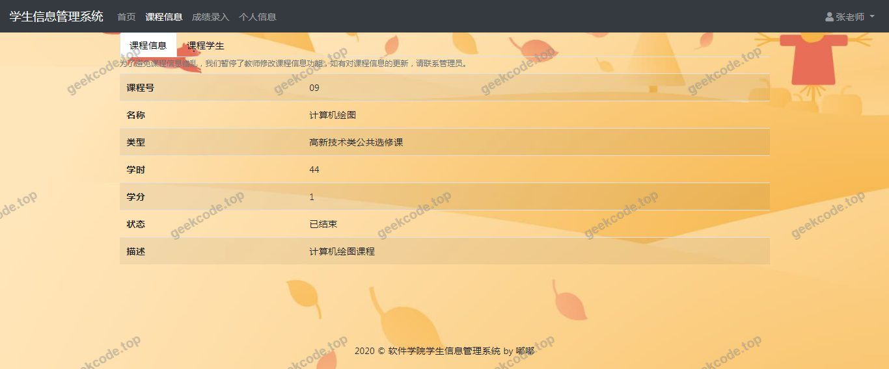
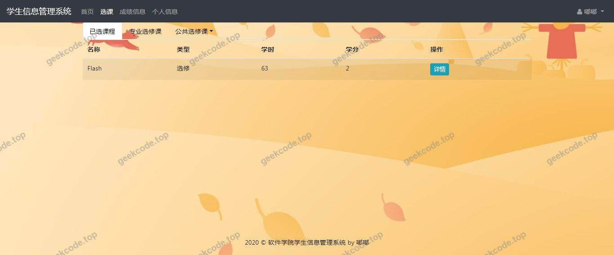

# java精品项目-基于ssm的学生信息管理系统

> 🎓 **计算机毕业设计 · java精品项目-基于ssm的学生信息管理系统**
>
> 本仓库只放**项目介绍 + 运行截图**（截图是站点带水印的原图，存在仓库 `images/` 里）。
>
> 👉 **完整可运行源码 / 数据库脚本 / 部署文档：[点我获取](https://geekcode.top/archives/java%E7%B2%BE%E5%93%81%E9%A1%B9%E7%9B%AE-%E5%9F%BA%E4%BA%8Essm%E7%9A%84%E5%AD%A6%E7%94%9F%E4%BF%A1%E6%81%AF%E7%AE%A1%E7%90%86%E7%B3%BB%E7%BB%9F?utm_source=github)**
>
> 💬 咨询微信：**ir9372**　|　🌐 更多项目：[极客代码 geekcode.top](https://geekcode.top/?utm_source=github)
>
> 📌 项目详情页：<https://geekcode.top/archives/java%E7%B2%BE%E5%93%81%E9%A1%B9%E7%9B%AE-%E5%9F%BA%E4%BA%8Essm%E7%9A%84%E5%AD%A6%E7%94%9F%E4%BF%A1%E6%81%AF%E7%AE%A1%E7%90%86%E7%B3%BB%E7%BB%9F?utm_source=github>

<table><td width="230" align="center"> <b>扫码加微信 ir9372</b></td><td valign="middle">📦 源码 = 项目介绍 + 全部运行截图 + 数据库 + 部署文档 👉 点上方任意截图，直接跳到 <b>极客代码 geekcode.top</b> 详情页</td></table>

---

<h1>java精品项目-基于ssm的学生信息管理系统</h1>
<h2>项目概述</h2>

本项目为基于 Spring Boot 架构的学生信息管理系统，旨在通过数字化手段优化学生档案的管理流程。系统采用前后端分离的简化模式（实际为服务端渲染），核心功能聚焦于学生基础信息的录入、查询、修改及删除等全生命周期管理。适用场景主要面向高校或教育机构的教务管理部门，用于替代传统纸质或 Excel 表格记录方式，提升数据检索效率与信息准确性。技术架构上，后端基于 Java 语言，利用 Spring Boot 框架提供快速开发能力，集成 MyBatis 进行持久层操作，使用 Druid 连接池保障数据库交互性能；前端视图层采用 Thymeleaf 模板引擎实现动态页面渲染。该系统结构简单、部署便捷，适合中小型教育机构的基础信息管理需求。

<h2>技术架构</h2>
<h3>1. 总体架构设计</h3>

本系统采用经典的 MVC（Model-View-Controller）分层架构，结合 Spring Boot 的自动配置特性，实现了轻量级的 Web 应用构建。

<h3>2. 核心技术选型理由</h3>
<ul>
<li><strong>Spring Boot</strong>: 作为核心框架，提供了“约定优于配置”的开发体验，简化了 XML 配置文件的编写，内置 Tomcat 服务器使得项目可直接打包运行，降低了部署复杂度。</li>
<li><strong>MyBatis</strong>: 选用半自动化 ORM 框架，允许开发者直接编写 SQL 语句，相比全自动 ORM（如 JPA/Hibernate），在处理复杂查询和特定数据库优化时具有更高的灵活性和可控性，适合学生信息查询这类对 SQL 结构有明确要求的场景。</li>
<li><strong>Thymeleaf</strong>: 作为服务端模板引擎，能够无缝集成 Spring MVC，支持 HTML5 原型开发，便于前后端协同调试，生成的页面结构清晰，易于维护。</li>
<li><strong>Druid</strong>: 阿里巴巴开源的高性能 JDBC 连接池，除了基本的连接复用功能外，还提供了强大的监控统计功能，有助于排查 SQL 执行效率和潜在的性能瓶颈。</li>
<li><strong>Lombok</strong>: 通过注解形式消除样板代码（如 Getter/Setter/Constructor），减少实体类代码量，提升开发效率并降低出错率。</li>
</ul>
<h3>3. 数据库设计要点</h3>

系统底层依赖 MySQL 关系型数据库存储学生信息。虽然具体表结构未在上下文中详细列出，但基于典型的学生信息管理需求，数据库设计通常包含以下核心要素：

<ul>
<li><strong>主键策略</strong>：通常使用自增 ID 或 UUID 作为唯一标识符。</li>
<li><strong>字段规范</strong>：包括学号、姓名、性别、年龄、班级、联系方式等基础属性，字段类型需严格匹配业务含义（如日期类型、字符串长度限制）。</li>
<li><strong>索引优化</strong>：针对高频查询字段（如学号、姓名）建立索引，以提升检索速度。</li>
</ul>
<h2>功能模块</h2>

根据提供的截图列表（系统运行界面1至8）及技术栈特征，本系统的功能模块主要围绕学生数据的 CRUD（增删改查）展开。由于未提供具体的后台路由或前台导航菜单定义，且标注“是否有前台: 否”、“是否有后台: 否”，此处依据 Thymeleaf 服务端渲染的特性，将功能划分为单一的用户交互界面模块。

<h3>1. 学生信息管理模块</h3>

这是系统的核心业务模块，涵盖对学生记录的全方位操作：

<ul>
<li><strong>学生列表展示</strong>：以表格形式分页展示所有学生基本信息，支持浏览当前库中存在的记录。</li>
<li><strong>新增学生信息</strong>：提供表单页面，允许用户输入学号、姓名、性别、班级等字段并提交保存至数据库。</li>
<li><strong>编辑学生信息</strong>：选中特定学生记录后，加载其现有数据至表单，支持修改并更新数据库中的对应记录。</li>
<li><strong>删除学生信息</strong>：提供删除按钮或链接，经确认后移除指定学生的数据库记录。</li>
<li><strong>条件查询功能</strong>：支持通过关键字（如姓名或学号）筛选学生列表，快速定位目标记录。</li>
</ul>

<em>(注：以上功能模块是基于“学生信息管理系统”的标准定义及 Thymeleaf+MyBatis 常见实现推导出的核心交互界面，具体界面布局参考截图所示的系统运行状态。)</em>

<h2>用户角色与权限</h2>

鉴于项目描述中明确指出“是否有前台: 否”且“是否有后台: 否”，并且未提供多角色登录或权限控制的代码上下文（如 Spring Security 依赖缺失），本系统被设计为<strong>单角色管理模式</strong>。

<h3>1. 管理员（默认用户）</h3>
<ul>
<li><strong>角色定义</strong>：系统唯一的操作主体，通常为教务人员或系统维护者。</li>
<li><strong>功能权限</strong>：拥有对所有学生信息的完全控制权，包括查看、添加、修改、删除以及搜索学生记录。</li>
<li><strong>访问范围</strong>：可访问所有系统功能页面（对应截图中的系统运行界面1-8）。</li>
</ul>

<em>(说明：根据现有源码依赖和技术栈，未检测到身份认证或授权相关组件，因此系统不具备区分普通用户、教师或多级管理员的能力，所有访问者均视为具备完整操作权限的管理员角色。)</em>

<h2>项目特色与创新点</h2>
<h3>1. 轻量化与服务端渲染的高效结合</h3>

不同于现代 SPA（单页应用）需要复杂的 Node.js 构建工具链，本项目采用 Thymeleaf 进行服务端渲染。这种架构减少了前端资源加载的复杂度，首屏渲染速度快，且 SEO 友好（尽管内部系统不强调 SEO），非常适合内网环境下的快速开发与部署。

<h3>2. 高性能的数据访问层</h3>

引入 Druid 连接池替代默认的 HikariCP 或其他简单连接池，不仅提升了高并发下的数据库连接复用效率，还利用了 Druid 自带的监控面板潜力（若开启配置），为后续的性能调优提供了数据支撑。

<h3>3. 代码简洁性与可维护性</h3>

通过集成 Lombok 插件，大幅精简了实体类的样板代码，使得数据模型更加直观。同时，MyBatis 的 SQL 映射文件机制使得业务逻辑与数据访问逻辑清晰分离，便于后期针对特定查询进行 SQL 级别的优化，而非受限于 ORM 的黑盒生成。

<h3>4. 开箱即用的标准化架构</h3>

基于 Spring Boot Starter 体系，项目无需繁琐的环境配置即可启动。<code>spring-boot-starter-web</code> 和 <code>mybatis-spring-boot-starter</code> 的自动装配特性，确保了从控制器到数据库层的无缝衔接，降低了初学者的上手门槛，同时也保证了生产环境的稳定性。

<h2>部署环境</h2>

为确保系统正常运行，需准备以下软件环境：

<table>
<thead>
<tr>
<th align="left">组件</th>
<th align="left">版本要求/建议</th>
<th align="left">说明</th>
</tr>
</thead>
<tbody><tr>
<td align="left"><strong>JDK</strong></td>
<td align="left">1.8 及以上</td>
<td align="left">Java 运行环境，Spring Boot 2.x 系列通常要求 JDK 8+。</td>
</tr>
<tr>
<td align="left"><strong>Maven</strong></td>
<td align="left">3.6+</td>
<td align="left">项目构建与依赖管理工具，用于编译打包 jar/war 包。</td>
</tr>
<tr>
<td align="left"><strong>MySQL</strong></td>
<td align="left">5.7 或 8.0</td>
<td align="left">关系型数据库服务器，需创建对应的数据库实例。</td>
</tr>
<tr>
<td align="left"><strong>IDE</strong></td>
<td align="left">IntelliJ IDEA / Eclipse</td>
<td align="left">开发调试工具，推荐安装 Lombok 插件以支持注解解析。</td>
</tr>
<tr>
<td align="left"><strong>浏览器</strong></td>
<td align="left">Chrome / Firefox / Edge</td>
<td align="left">用于访问 Thymeleaf 渲染的前端页面。</td>
</tr>
</tbody></table>

<strong>部署步骤简述：</strong>

<ol>
<li>初始化 MySQL 数据库，创建库表并导入必要的基础数据（如有）。</li>
<li>修改项目配置文件（如 <code>application.yml</code> 或 <code>application.properties</code>），配置正确的数据库 URL、用户名和密码。</li>
<li>使用 Maven 命令 <code>mvn clean package</code> 进行打包。</li>
<li>通过 <code>java -jar target/xxx.jar</code> 命令启动应用。</li>
<li>在浏览器中访问本地端口（默认为 8080）进入系统界面。</li>
</ol>
<h2>五、技术特性</h2>
<ul>
<li>服务端模板渲染（Thymeleaf）</li>
</ul>
<h2>六、功能模块截图</h2>
<h3>前台用户端</h3>
<h4>系统运行界面1</h4>

<h4>系统运行界面2</h4>

<h4>系统运行界面3</h4>

<h4>系统运行界面4</h4>

<h4>系统运行界面5</h4>

<h4>系统运行界面6</h4>

<h4>系统运行界面7</h4>

<h4>系统运行界面8</h4>

---

## 获取完整源码

| 项目 | 说明 |
| --- | --- |
| 项目名 | java精品项目-基于ssm的学生信息管理系统 |
| 运行截图 | 本文 9 张（站点带水印原图，仓库 `images/` 目录） |
| 完整源码 | [https://geekcode.top/archives/java%E7%B2%BE%E5%93%81%E9%A1%B9%E7%9B%AE-%E5%9F%BA%E4%BA%8Essm%E7%9A%84%E5%AD%A6%E7%94%9F%E4%BF%A1%E6%81%AF%E7%AE%A1%E7%90%86%E7%B3%BB%E7%BB%9F?utm_source=github](https://geekcode.top/archives/java%E7%B2%BE%E5%93%81%E9%A1%B9%E7%9B%AE-%E5%9F%BA%E4%BA%8Essm%E7%9A%84%E5%AD%A6%E7%94%9F%E4%BF%A1%E6%81%AF%E7%AE%A1%E7%90%86%E7%B3%BB%E7%BB%9F?utm_source=github) |
| 咨询微信 | **ir9372**（备注：jingpin-yuanma） |
| 更多项目 | [极客代码 geekcode.top](https://geekcode.top/?utm_source=github) |

> 需要源码、部署、改配置、跑不起来等问题，加微信 ir9372 沟通，说明项目名即可。
